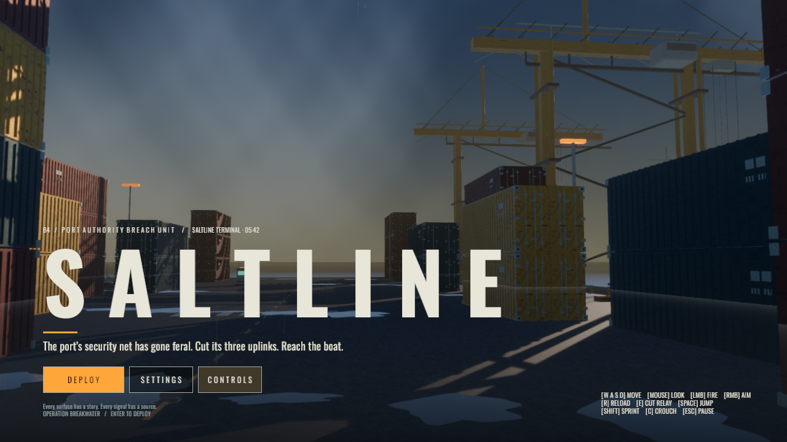

# SALTLINE

A native Linux procedural port FPS built with Bevy 0.20.

Run `cargo run -p saltline-game`. Enter deploys; WASD moves, mouse looks,
left mouse fires, right mouse aims, R reloads, Shift sprints, C crouches,
Space jumps, E deactivates nearby relays/extracts, Esc pauses.
Disable all three relays along the central dock road, then reach the boat.
Enter restarts after death or victory.

`cargo test -p saltline-game --test gameplay` runs renderer-free gameplay checks.
`./scripts/screenshot.sh` captures deterministic 1280×720 inspection views.
Generated captures and logs live under `tmp/` and are not approved baselines.

The dependency direction is game → world → models, with game also using models.
Models owns cached meshes/materials and procedural assemblies; world supplies the
port layout and obstacle bounds; game owns simulation, controls and presentation.

Current implementation uses axis-separated collision and sampled visibility checks.
Performance and reference-quality acceptance must be assessed on the rendered build;
no hardware performance claim is made without measurements.

Verification performed in this devcontainer:

- Workspace check and incremental debug build pass (Bevy 0.20.1).
- Five headless tests pass, including collision, damage/reload, detection/death,
  obstruction, and mission progression.
- The rendered action-driven mission replay destroyed 10 enemies and reached victory.
- Xvfb/xdotool exercised deployment, movement, look, aim, fire, reload and pause/resume.
- Port, rifle, Hound, drone and relay PNGs were captured and visually inspected.

`./scripts/window-smoke.sh` repeats window input checks. `./scripts/benchmark.sh`
runs a release-build hardware route three times and checks the 16.7 ms p95 budget.
It supports offscreen Vulkan without a display; software timing runs do not count
as hardware acceptance.

Rendering now defaults to the Medium quality profile. Static containers use cached
assemblies and distance detail, rain runs on the GPU, and the static environment
map is filtered once after warmup. World resolution scales independently of UI.
Use `--quality high` for the additional screen-space and volumetric effects.
See [rendering and performance](docs/performance.md) for controls, benchmark
methodology, and visual inspection views.

The startup title screen uses the live procedural port with a separate looping
cinematic camera. Click **Deploy** (or press Enter) to start, **Settings** to toggle
camera motion with M, or **Controls** for the input legend. Esc closes subpanels.
The foreground title stacks are presentation only and are hidden during gameplay.

Run `scripts/title-screen.sh` to save two startup screenshots in
`tmp/screenshots/title-{70,170}.png`. This uses software Vulkan under Xvfb;
normal launches retain the selected hardware renderer. The Oswald font is embedded in the executable, so menu text does not depend on
the launch directory or an external assets folder. Its SIL Open Font License is
in `assets/fonts/OFL.txt`.

For GitHub CI, browser builds, releases, and Wavedash setup, see
[the release guide](docs/releases.md).
